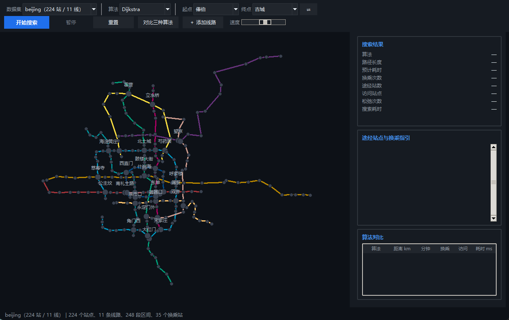
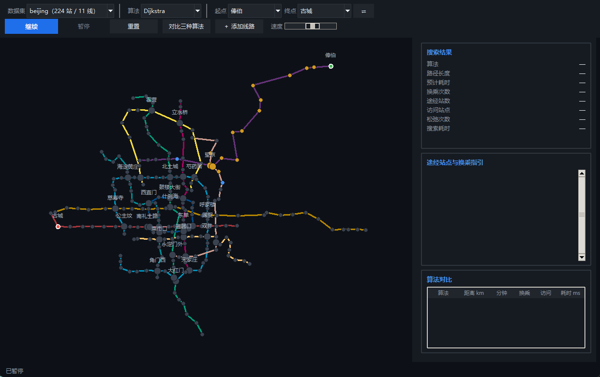
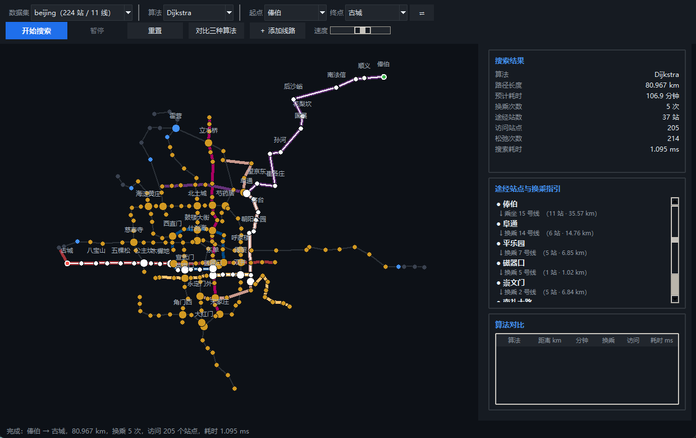
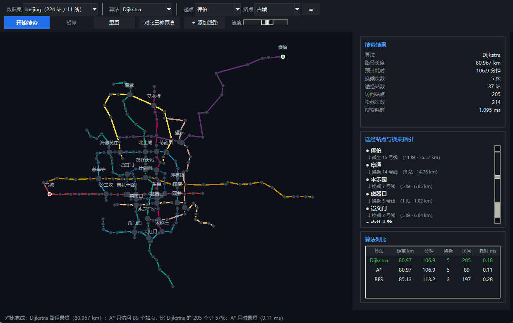
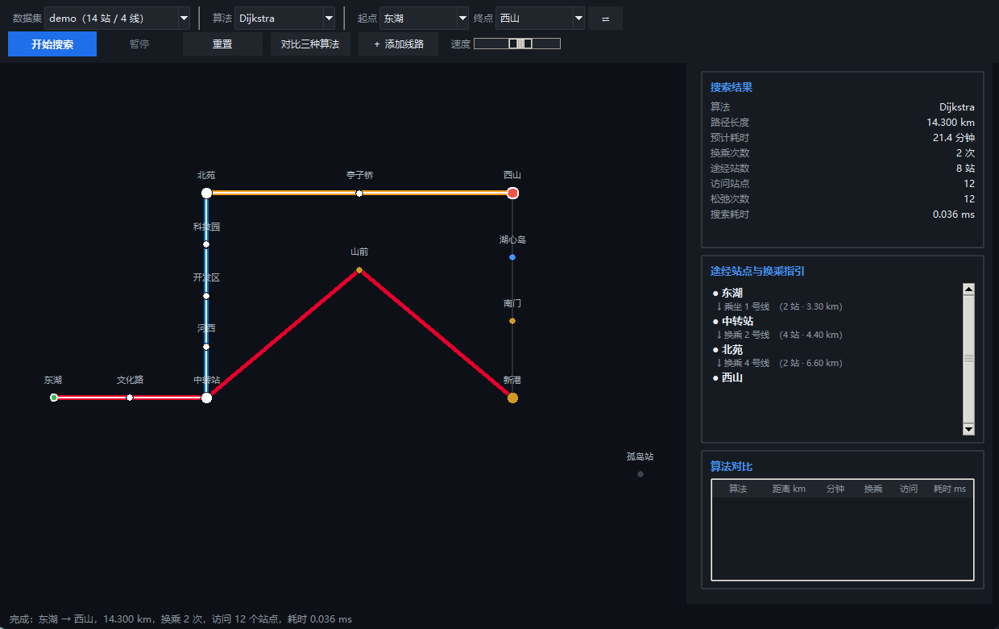
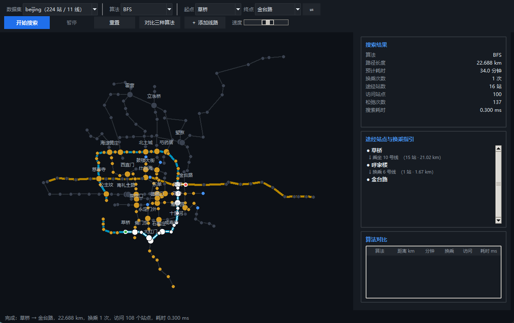
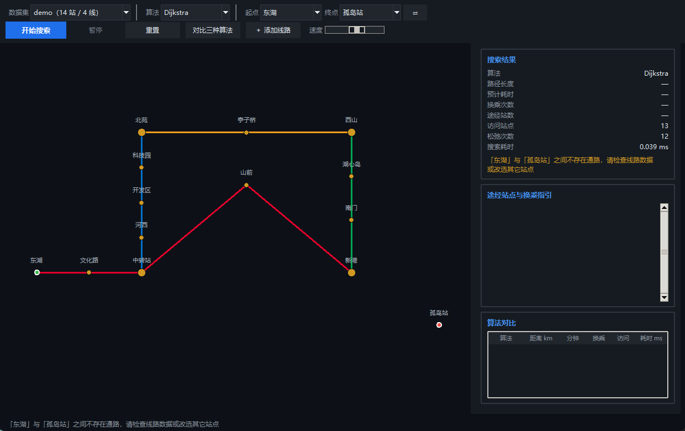

# 城市交通路径导航系统设计与实现

**《数据结构实践》课程实验报告**

| 项目 | 内容 |
|---|---|
| 实验选题 | 选题一 · 城市交通路径导航系统 |
| 实现语言 | Python 3（Tkinter） |
| 姓名 |  |
| 学号 |  |
| 班级 |  |
| 日期 |  |

---

## 目录

- [第一章 需求分析与问题建模](#第一章-需求分析与问题建模)
- [第二章 数据结构设计](#第二章-数据结构设计)
- [第三章 算法设计与实现](#第三章-算法设计与实现)
- [第四章 系统演示与结果分析](#第四章-系统演示与结果分析)
- [第五章 总结与收获](#第五章-总结与收获)
- [附录](#附录)

---

## 第一章 需求分析与问题建模

### 1.1 问题背景

在城市轨道交通网络中，乘客关心的往往不是同一个问题：赶时间的人要的是总耗时最短，而带着行李或对换乘敏感的人要的是换乘次数最少。这两者常常不一致——同线路直达可能绕远，抄近路却要多换一次车。本实践要做的就是把真实线路网抽象成图，用三种不同的搜索算法分别回答这两类问题，并把搜索过程可视化。

### 1.2 把线路网抽象为图 G = (V, E)

建模结果如下：

- **顶点集合 V**：一个站点对应一个顶点。站点只在列车停靠这一点上承载信息，因此顶点的属性取 `(ID, 名称, 坐标)`。
- **边集合 E**：线路上**相邻的两站**之间连一条边。注意这里的"相邻"是线路意义上的相邻，而不是地理上最近的站点对——乘客只能在列车停靠的相邻两站之间移动。

边的属性取 `(距离, 线路 ID)`：

- **距离**是该区间的实际走行长度，单位 km。它由两站坐标算出的直线距离乘以该线路的**绕行系数**得到。引入绕行系数是因为线路不可能沿直线铺设，必须保留一点冗余。
- **线路 ID** 是换乘判定的唯一依据。同一个站点可以同时属于多条线路，此时它是一个换乘站；乘客从一条线路换到另一条线路，就必须在换乘站完成。

**一个关键约束**：所有线路的绕行系数都不小于 1，因此每条边的长度都不小于它两端站点的直线距离。这条看似平凡的约束，正是 A\* 的启发函数能够保证最优性的全部依据（见 3.2 节）。

### 1.3 建模中的两个取舍

**为什么不用"站数"衡量距离。** 站与站间距并不相等，用站数做权重会把 4 km 的郊区区间和 0.8 km 的市区区间等同看待，算出来的"最快路径"没有意义。因此权重取实际里程；由于全网线路使用接近的旅行速度，里程与时间近似成正比，以里程为权重同时也就是在优化时间。

**为什么"最少换乘"不能简单地做 BFS。** 直觉上"换乘少"似乎等于"坐的站少"，但两者没有必然联系：一条绕城的环线可以把乘客从甲地送到乙地而中途一次也不必换车，站数却远多于"换两次车走直线"的方案。因此最少换乘必须在**换乘次数**这个量上搜索，而不是在站数上（3.3 节展开）。

### 1.4 功能需求

| 模块 | 需求 |
|---|---|
| 地图加载与存储 | 从 `.json` 或 `.txt` 外部文件读取站点（坐标、站名）与线路（连接关系、权重），程序中不出现硬编码的线路数据 |
| 多准则搜索 | Dijkstra 求最快路径；BFS 求最少换乘；A\* 用欧几里得距离作启发函数 |
| 交互式界面 | 可视化站点网络；通过下拉菜单或点击地图选择起终点；高亮显示最终路径并列出途经站点清单 |
| 异常处理 | 两点不连通时给出明确提示而不是崩溃或返回错误路径 |
| 动态编辑 | 支持在运行时增删站点与线路 |

### 1.5 使用的数据

| 数据集 | 规模 | 来源 | 用途 |
|---|---|---|---|
| `data/beijing` | 224 站 / 11 线 / 248 段区间 | 公开的北京地铁站点数据（取自 Wikipedia 与 OpenStreetMap），线路顺序由几何方法还原 | 主要演示、性能对比 |
| `data/metro` | 65 站 / 9 线 / 72 段区间 | 按真实城市结构构造（环线 + 直径线 + 外围线） | 规模对照 |
| `data/demo` | 14 站 / 4 线 | 手工设计，含一处故意绕远的路段与一个孤立站 | 报告中的手工验证与异常处理演示 |

三者共用同一套加载格式，程序启动时自动扫描 `data/` 下的全部子目录，切换数据集不需要改任何代码。真实数据的还原过程见 4.4 节。

---

## 第二章 数据结构设计

### 2.1 存储结构：邻接表而不是邻接矩阵

城市交通图是典型的**稀疏图**。本站示例网络有 65 个站点、72 段区间，平均每个站只与 2.2 个邻居相连；真实城市地铁也类似，绝大多数车站只有前后两个邻站，只有换乘站才连到 3 个以上。

两种存储方式在本问题上的对比如下（n 为站点数，e 为区间数）：

| 存储方式 | 空间开销 | 扩展一个站点 | 判断两点是否相邻 |
|---|---|---|---|
| 邻接矩阵 | O(n²)，本站需 65 × 65 = 4225 个格子 | O(n)，要扫描整行 | O(1) |
| **邻接表** | **O(n + e)，本站约 65 + 144 个表项** | **O(deg(v))，本站平均 2.2 次** | O(deg(v))，平均 2.2 次 |

关键在于 4225 个格子里，有边的只占约 3.4%，剩下 96% 以上的空间和扫描时间都是浪费。而三种搜索算法最频繁的操作恰恰是"取出某个站点的所有邻居"，这正是邻接表最擅长的。唯一吃亏的是"判断两点是否相邻"从 O(1) 变成 O(deg(v))，但本题根本不需要这个操作。

因此 `Graph` 类内部维护三份索引：顶点表 `vid -> Vertex`、邻接表 `vid -> [Edge, ...]`、线路表 `lid -> Line`。

**为什么邻接表里会存在"并行边"。** 地铁双向通行，所以线路上相邻的两站在表中各有一条指向对方的边；而同一对相邻站点如果同时属于两条线路，表中就会出现两条起讫点相同、线路 ID 不同的边。这看起来冗余，却正是换乘判定所依赖的信息：一个站点的"线路 ID 集合"就是从它的并行边里去重得到的，集合大小超过 1 就是换乘站。

### 2.2 优先队列（二叉堆）在 Dijkstra 中的作用

Dijkstra 每一轮都要做同一件事：**在尚未确定的站点中，找出当前距离估计值最小的那一个**。这一步的性能决定了整个算法的复杂度：

| 实现方式 | 取最小 | 插入 | 总复杂度 |
|---|---|---|---|
| 邻接矩阵 + 线性扫描 | O(n) | O(1) | O(n²) |
| 有序数组 | O(1) | O(n) | O(n²) |
| **二叉堆（`heapq`）** | **O(log n)** | **O(log n)** | **O((n + e) log n)** |

二叉堆把"取最小"和"插入"都压到对数级，使总复杂度从 O(n²) 降到 O((n + e) log n)。本站 65 个站点、144 条有向边，堆实现的优势还不明显；但真实城市地铁动辄数百站，O(n²) 与 O(e log n) 的差距会迅速拉开。

Python 的 `heapq` 只提供最小堆，且**不支持修改堆中已有元素的键值**。标准解法是**懒惰删除**：松弛成功时不去修改堆里那条旧记录，而是直接压入一条新的，等旧记录被弹出时检查它是否已经过期（该站点是否已被确定），过期就丢弃。这样一来堆中元素数量最多是 O(e) 而不是 O(n)，空间上仍然可以接受，而代码不必自己实现可下滤的堆。

### 2.3 状态空间：最少换乘为什么要给状态加上"线路"

三种算法里，最少换乘 BFS 的数据结构最特殊。它搜索的状态不是"站点"，而是 **`(站点, 当前所乘线路)` 这一对数**。

原因在于代价的计算方式：从站点 A 到相邻站点 B，如果 A、B 同属线路 L 且乘客本来就坐在 L 上，这一步的**换乘代价是 0**；如果乘客是从别的线路换到 L 上再坐过去，代价是 1。**同一个站点、同一个后继动作，代价却依赖"你是怎么来的"**——这种"代价依赖历史"的性质要求把历史编进状态里。只记录"到某站最少换乘几次"是不够的，因为还得知道到达时坐在哪条线上。

于是状态数从 n 扩大到最多 n·L（L 为单站所属线路数上限，本站为 2～4），转移分成两类：

- **乘车**：`(v, L) -> (v', L)`，沿线路前进一站，换乘次数 +0，路程 +w；
- **换乘**：`(v, L) -> (v, L')`，在同一站改乘另一条线路，换乘次数 +1，路程 +0。

### 2.4 执行路径的存储

搜索结果用 `Route` 对象保存，其中既有扁平的站点序列 `path`，也有按线路分段的 `legs`。分段结构是必需的——乘客需要知道"在哪一站换哪条线"，而不只是一个站点列表。每一段 `Leg` 记录线路 ID、线路名、颜色、包含的站点、该段里程与耗时。

---

## 第三章 算法设计与实现

### 3.1 Dijkstra：松弛操作

Dijkstra 的正确性建立在一条性质上：**边的权重非负时，从起点出发距离估计值最小的那个未确定站点，其估计值已经是最终答案**。因为任何绕经其它站点的走法都只会更长。

算法的核心是松弛（Relaxation）：

```
Dijkstra(G, s, t):
    dist[s] ← 0；其余 dist[v] ← +∞
    prev[v] ← ∅
    heap ← {(0, s)}
    settled ← ∅

    while heap 非空:
        (d, u) ← heap 中取出 d 最小者
        if u ∈ settled: continue            // 惰性删除：过期记录丢弃
        settled ← settled ∪ {u}
        if u = t: break                     // 终点一旦确定即为最优

        for each edge (u, v, w) ∈ Adj[u]:
            if v ∈ settled: continue
            if dist[u] + w < dist[v]:       // ← 松弛
                dist[v] ← dist[u] + w
                prev[v] ← (u, line(u,v))
                push(heap, (dist[v], v))

    if t ∉ settled: return 不可达
    return 沿 prev 从 t 回溯到 s
```

实现上有两处值得一提：

- **"终点一旦确定就退出"** 是安全的。堆中弹出的距离估计值单调不减，因此第一个被弹出的终点就是最优解，无需把整张图算完。
- **"跳过已确定的邻居"** 也是一个有效剪枝。已确定站点的距离不会再被改进，对它做松弛纯属浪费。

### 3.2 A\*：启发函数的推导与正确性

Dijkstra 的问题在于"均匀地向外扩张"：它按离起点的距离推进，因此会朝**所有方向**同时探索，包括那些明显背道而驰的方向。A\* 的思路是给每个站点补上一个"到终点还有多远"的估计，优先探索看起来更有希望的站点。

定义：

- `g(n)`：从起点到 n 的**实际**已走距离（就是 Dijkstra 里的 `dist[n]`）；
- `h(n)`：从 n 到终点的**估计**剩余距离；
- `f(n) = g(n) + h(n)`：经过 n 到达终点的总代价估计。

A\* 与 Dijkstra 的代码**只差堆的排序键**：Dijkstra 按 `g` 排序，A\* 按 `f` 排序。本站取

$$h(n) = \sqrt{(x_n - x_t)^2 + (y_n - y_t)^2}$$

即站点 n 到终点的欧几里得直线距离。

**为什么这个 h 能保证 A\* 求出最优解。** 需要两个性质：

1. **可采纳性（admissible）**：`h(n) ≤ 从 n 到终点的真实最短距离`。由 1.2 节的约束，任何线路的实际走行距离都不小于直线距离，所以沿任何一条真实路径从 n 走到终点，其长度都不小于 n 与终点之间的直线距离，即 `h(n) ≤ 真实剩余距离`。可采纳性保证 A\* **不会漏掉最优解**——因为最优路径上任何一点的 f 值都不超过最优总代价。

2. **一致性（consistent）**：对任意边 `(u, v, w)` 有 `h(u) ≤ w + h(v)`。由三角不等式，`u` 到终点的直线距离不超过"u 到 v 的实际走行距离 + v 到终点的直线距离"，而实际走行距离 ≥ 直线距离 = `w` 的下界，故成立。一致性保证每个站点**最多被确定一次**，不必像 Dijkstra 那样依赖懒惰删除反复修正。

两个性质都成立，因此 A\* 第一次弹出终点时得到的就是最优解。

**h 越紧，搜索越省。** 本站的 h 在示例网络上相当紧，因此剪枝效果显著（见 4.3 节）。但要强调：**h 可采纳只是必要条件，不是充分条件**。4.4 节的网格实验会给出一个 h 完全失效的极端例子。

### 3.3 最少换乘 BFS：分层扩展

如 2.3 节所述，状态取 `(站点, 线路)`。两个代价的量纲不同，用**字典序**作为比较依据：

- 第一关键字是**换乘次数**，它是本算法唯一要最小化的目标；
- 第二关键字是**乘车路程**，用来在同换乘次数的方案里取最短的那条。

实现上用二叉堆按 `(换乘次数, 路程)` 排序。因为第一关键字是换乘次数，堆中所有"换乘 0 次"的状态必定先于"换乘 1 次"的状态被弹出，换乘 1 次的又先于 2 次的——**这正是"按层级扩展"的 BFS 语义**，只不过用一个堆来维护层级顺序，而不是 FIFO 队列。

**为什么必须加第二关键字。** 如果只用换乘次数作为排序依据，那么"换乘 2 次"的方案通常有很多个，取到哪一个完全取决于堆内部的比较顺序，结果会随数据的书写次序漂移。加上路程作为次关键字后，"最少换乘"的解被唯一确定，且在同换乘次数下取到最短的那条。

**它与 Dijkstra 的本质区别是代价的定义，而不是实现。** 前者度量"换了几次车"，后者度量"走了多少公里"。当两种准则给出不同答案时（4.2 节的分歧案例），差异就显现出来了。

### 3.4 复杂度分析

设 n 为站点数，e 为区间数，$L$ 为单个站点所属线路数的上限，$\bar{L}$ 为平均值。

| 算法 | 时间 | 空间 | 说明 |
|---|---|---|---|
| Dijkstra | $O((n + e)\log n)$ | $O(n + e)$ | 每个站点出堆一次 O(n log n)，每条边被松弛一次 O(e log n) |
| A\* | 最坏 $O((n + e)\log n)$，实际远低于此 | $O(n + e)$ | 上界与 Dijkstra 相同（h ≡ 0 时二者等价），但 h 越紧被确定的站点越少 |
| 最少换乘 BFS | $O((S + E_S)\log S)$，其中 $S ≤ n\bar{L}$，$E_S ≤ e\bar{L}$ | $O(S + n + e)$ | 状态数放大约 $\bar{L}$ 倍，转移数也同比例放大 |

本站示例网络取 $n = 65$、$e = 72$、$\bar{L} ≈ 2.2$，三种算法的规模都在几百次堆操作的量级。

需要说明的是，A\* 的复杂度**无法用一个与 h 无关的紧界描述**——它的实际表现完全取决于启发函数的质量。这也是为什么 4.3 节用"访问站点数"而不是仅有理论公式来对比。

### 3.5 让同一个算法既能演示又能测性能

界面要求"把搜索过程动画演示出来"，性能测试又要求"测出算法的真实耗时"，这两件事天然冲突：为了动画，算法必须在每一步停下来等界面刷新；为了准确计时，算法必须一口气跑完。

解决办法是把每个搜索算法都写成 **Python 生成器**。算法在关键位置 `yield` 出事件（"站点 X 被确定"、"站点 Y 进入前沿"），由界面按节拍逐个消费：

```python
def run(self, graph, start, goal, animate=True):
    for event in self._timed(self._search(graph, start, goal, animate, stats), clock):
        yield event
```

- `animate=True`：界面每 24 毫秒取走若干个事件并刷新画面，用户看到的是逐层扩散的搜索过程；
- `animate=False`：调用方循环消费但什么也不做，算法相当于一口气跑完，测到的就是纯粹的算法开销。

**三个算法走的是同一条代码路径**，性能对比因此是公平的：不存在"为了演示写的慢版本"和"为了测试写的快版本"两套代码。

计时还有一处细节：生成器在 `yield` 处会挂起，把控制权交还给界面，界面渲染和等待下一帧的这段时间也会流逝。如果直接用"结束时刻 − 开始时刻"，量出来的其实是**用户设置的演示速度**而不是算法耗时（实测最大偏差可达 1300 ms 对 0.5 ms）。为此实现了一个 `_AlgoClock`，在每次 `next()` 前后打点，只累加两次打点之间的差值，挂起等待的时间被自然排除。

---

## 第四章 系统演示与结果分析

### 4.1 界面与操作



界面分三块：顶部工具栏用于选择数据集、算法、起终点和演示速度；左侧画布绘制网络全图；右侧面板依次显示本次搜索的统计数字、途经站点与换乘指引、三种算法的对比表。

操作方式：左键点击站点设为起点，右键弹出菜单（设为起点／设为终点／删除该站点）；滚轮缩放，按住拖动平移，双击画布回到全览。工具栏的"＋ 添加线路"可以连接两个已有站点新建线路——网络的增删会立即反映到画布和下拉框上，不需要重启程序。站点密集时，站名会自动避让：只有不与已放下的标签重叠的才会显示，并且起点终点、结果路径上的站、换乘站依次享有更高的优先级。



搜索过程用颜色区分状态：**蓝色**是位于前沿（已进入堆或队列、尚未确定）的站点，**橙色**是已被算法确定的站点，搜索前沿像波纹一样从起点扩散出去。



搜索完成后，结果路径以加粗高亮显示，未经过的线路被压暗，右侧同时列出统计数据和换乘指引。



点击"对比三种算法"会一次性跑完三种算法并列表比较。上图的起终点是"俸伯 → 古城"（分别在北京东北与西郊，纵贯全城）：Dijkstra 与 A\* 给出同一条路径（80.967 km，换乘 5 次），但 **A\* 只访问了 89 个站点，Dijkstra 访问了 205 个**；最少换乘 BFS 给出的则是 85.135 km、换乘 3 次的另一条路线。

可以看到三种算法**并不总是给出同样的结果**：前两者的目标是"路程最短"，第三个的目标是"换乘最少"，目标不同，答案自然可能不同。

### 4.2 正确性验证：手工核对

用于核对的是 `data/demo` 网络。它只有 14 个站、4 条线路，规模小到可以完全手工推演，但拓扑经过专门设计：**1 号线故意把"山前"一站抬高到 y = 2.5 绕了一段远路**，使得"东湖 → 西山"这个起终点对上同时存在两条有意思的走法。

手工推演过程（边长 = 两站直线距离 × 1.10 绕行系数）：

| 走法 | 具体路线 | 换乘 | 计算 | 总里程 |
|---|---|---|---|---|
| 乙路 | 东湖→文化路→中转站 —〔2 号线〕→ 北苑 —〔4 号线〕→ 亭子桥→西山 | 2 次 | 3×1.10 + 4×1.10 + 6×1.10 | **14.300 km** |
| 甲路 | 东湖→文化路→中转站→山前→新港 —〔3 号线〕→ 西山 | 1 次 | 10.8102×1.10 + 4×1.10 | **16.291 km** |

程序输出与手工推演逐项对照：

| 算法 | 输出里程 | 换乘 | 输出路径 | 与手工一致 |
|---|---|---|---|---|
| Dijkstra | 14.300 km | 2 | 东湖 → 文化路 → 中转站 → 河西 → 开发区 → 科技园 → 北苑 → 亭子桥 → 西山 | ✓ |
| A\* | 14.300 km | 2 | 与 Dijkstra 完全相同 | ✓ |
| BFS | 16.291 km | 1 | 东湖 → 文化路 → 中转站 → 山前 → 新港 → 南门 → 湖心岛 → 西山 | ✓ |

这里出现了本次实验最值得说明的现象：**最少换乘的路径（甲路，换乘 1 次）比最短路径（乙路，换乘 2 次）长了将近 2 公里**。两个指标给出了不同的答案，谁"更好"取决于乘客自己的偏好——这正是任务书要求同时实现两种算法的意义。



另外，测试脚本还用**朴素枚举法**做了独立交叉验证：在 demo 网络上枚举所有简单路径求出真正的最短距离，与 Dijkstra 的输出逐个比对，13 个有效站点两两之间的全部组合均一致。

### 4.3 对比测试

在两张网络上各取样 12 组起终点：构造的示例市地铁网（65 站 / 9 线 / 72 段区间）每组重复 60 次，真实的北京地铁主干网络（224 站 / 11 线 / 248 段区间）每组重复 30 次，都取平均值。

| 网络 | 算法 | 平均访问站点数 | 平均耗时 | 访问站点相对值 |
|---|---|---|---|---|
| 示例市（65 站） | Dijkstra | 33.2 | 0.019 ms | 1.00× |
| 示例市（65 站） | **A\*** | **8.5** | **0.011 ms** | **0.26×** |
| 示例市（65 站） | 最少换乘 BFS | 27.7 | 0.034 ms | 0.83× |
| 北京主干（224 站） | Dijkstra | 120.1 | 0.063 ms | 1.00× |
| 北京主干（224 站） | **A\*** | **45.6** | **0.041 ms** | **0.38×** |
| 北京主干（224 站） | 最少换乘 BFS | 115.6 | 0.116 ms | 0.96× |

两张网络上的结论一致：规模从 65 站放大到真实的 224 站之后，A\* 依然只需要约三分之一的搜索量，说明这个优势不是小样本上的巧合。三点观察：

**第一，A\* 把搜索范围压缩到了 Dijkstra 的四分之一左右。** 原因是这个网络呈放射状，大量站点位于背离终点的方向上；Dijkstra 会沿着离起点的距离均匀地扩散到那些方向去，而 A\* 因为把"到终点还有多远"计入排序键，能更早地放弃这些分支。

**第二，A\* 在这里连耗时也更快。** 需要说明的是这并非必然：A\* 每弹出一个站点都要额外计算一次欧几里得距离，单次操作比 Dijkstra 更贵。在更小的网络或更松的启发函数下，A\* 完全可能比 Dijkstra 慢，尽管它访问的站点更少。这也是为什么衡量搜索效率应当看**访问站点数**而不是仅看耗时。

**第三，最少换乘 BFS 是三者中最慢的。** 它的状态空间被放大了约 2.2 倍（每站平均属于 2.2 条线路），堆操作次数随之增加，而且它使用的两个关键字中有一个是整数换乘次数，比较的区分度不如纯浮点距离。

下面是启发函数质量对搜索规模的量化影响。用同一组起终点，只改变 h 的放大系数：

| h 的系数 | 平均访问站点 | 平均耗时 | 仍为最短路径 | 平均超出最优 |
|---|---|---|---|---|
| 0（退化为 Dijkstra） | 120.1 | 0.092 ms | 12 / 12 | — |
| 0.5 | 87.6 | 0.072 ms | 12 / 12 | — |
| 0.8 | 63.5 | 0.055 ms | 12 / 12 | — |
| **1.0（欧几里得，本实现）** | **45.6** | **0.041 ms** | **12 / 12** | — |
| 1.1 | 37.8 | 0.038 ms | 12 / 12 | — |
| 1.3 | 28.8 | 0.027 ms | **10 / 12** | 1.8% |

系数不超过 1 时 h 仍然可采纳，搜索范围随系数增大而单调收缩，结果也始终是最优的；一旦超过 1，h 开始高估真实代价，搜索会更快，但**代价是可能不再给出最短路径**——系数 1.3 时 12 组里有 2 组的结果比最短路长，平均超出 1.8%。这组数据把"启发函数越紧越好"与"必须保持可采纳"这层权衡完整地展示了出来。

### 4.4 真实数据的接入

任务书的"优秀"档要求"能处理复杂的真实地铁线路图"，为此本项目写了 `tools/import_real_metro.py`，把一份公开的北京地铁站点数据转换成程序使用的 `network.json`。数据源保存在 `tools/source/` 下，每行一个站点（`纬度, 经度, 车站名, 线路名`），共 328 条。

原始数据有两个问题需要处理：

**一、没有给出站点在线路上的先后顺序。** 原始文件是按站名的字母序排列的。解决办法是「最近邻链 + 2-opt」：穷举每个站点作为起点各跑一遍最近邻链，再用 2-opt 反复反转子路径消除交叉，最后取总长度最短的那条链。地铁线路是近似一维的曲线，最短的那条链就是它的真实站序 —— 还原出来的 1 号线（苹果园 → 四惠东）、2 号线（环线）、4 号线、10 号线（环线）、13 号线的站序都与实际完全一致。

**二、换乘站在数据里只出现一次。** 一个物理站点（例如西直门，同时属于 2、4、13 号线）在原始数据中只归给了其中一条线，其余线路的记录里直接没有它，于是线路的站序上会留下异常的空缺。解决办法是**几何插值**：如果某个已知站点的坐标恰好落在某条线路相邻两站的连线上（偏离小于 450 米），就说明它本来就在这条线上，按投影位置插回去。这样一共补回 36 处换乘记录，西直门、西单、宣武门、复兴门这些枢纽都回到了它们应在的位置。

**三、过程中还发现并处理了一处坏数据。** 八通线的"高碑店"被记成 (39.333, 115.85)——离最近的同线车站有 50 多公里，足以把整条线路的站序带偏。清洗规则是：若某一段的跨度远超该线路的正常站距（中位数的 4 倍），就剔除这一段上离群的那一端，然后重新还原。共剔除 10 个坐标异常的站点。

最终产出的网络有 **224 个站点、11 条线路、248 段区间、35 个换乘站，且完全连通**（只保留了最大连通分量 —— S1 线、西郊线等远郊线本来与主网就是弱连接，其换乘关系没能完整还原）。这张真实的图上出现了比 demo 网络更生动的准则分歧：

| 起终点 | Dijkstra | 最少换乘 BFS |
|---|---|---|
| 草桥 → 金台路 | 21.27 km，换乘 **7** 次 | 22.69 km，换乘 **1** 次 |

两个方案的路程只差 1.4 公里，换乘次数却差了 6 次。原因是这两个站都在 10 号线上，而 10 号线是**环线**——同一条线绕城半圈即可直达；而在直线方向上"抄近路"的那条路线，要在一连串密集的换乘站之间反复切换线路。这正是现实里"直达但绕远"与"抄近路却反复换乘"之间的取舍，也是本实验中最能说明"为什么要同时实现两种算法"的一个例子。



### 4.5 启发函数失效的一个特例

把同样的 A\* 放到规则网格网络上，情况完全不同。取网格的左上角到右下角：

| 规模 | 站点数 | 算法 | 访问站点 | 访问占比 |
|---|---|---|---|---|
| 28×28 | 784 | Dijkstra | 784 | 100.0% |
| 28×28 | 784 | A\*（欧几里得） | 784 | 100.0% |
| 28×28 | 784 | A\*（曼哈顿） | 784 | 100.0% |

**三个算法都访问了全部 784 个站点，A\* 一点便宜也没占到。** 这不是实现错误，而是问题的性质决定的：

从网格左上角走到右下角，任何"只向右、只向下"的路径长度都相同，全都是最短路径。对网格上任意一点 (i, j)，从起点走到它要 i + j 步，剩余距离是 2(s−1) − i − j，于是

$$f(i,j) = g + h = (i+j) + \big(2(s-1) - i - j\big) = 2(s-1)$$

**所有点的 f 值恒等于最优代价。** 堆里没有任何一个点比别的点"更有希望"，A\* 只能和 Dijkstra 一样把所有点都确定一遍。换成曼哈顿距离结果完全一样——因为在这个场景下曼哈顿距离是"紧"的，f 依然恒为常数。

这个反例说明：**h 可采纳只是 A\* 能剪枝的必要条件，能不能真正剪掉分支还取决于问题本身存在不存在可剪的分支**。放射状的地铁网络里大量站点"方向不对"，所以 A\* 有效；规则网格的对角路径上人人都是候选，A\* 就退化成了 Dijkstra。

### 4.6 异常处理



当两站之间不存在通路时（例如 demo 网络中故意设置的孤立站点"孤岛站"），三种算法都会返回明确的失败提示，界面在结果面板和状态栏同时显示"「东湖」与「孤岛站」之间不存在通路，请检查线路数据或改选其它站点"，而不是崩溃或返回一条错误的路径。

除此之外，测试脚本还覆盖了以下边界情况：

| 情况 | 预期行为 | 实测 |
|---|---|---|
| 起点与终点相同 | 返回只含起点的零长度路径，换乘 0 次 | ✓ |
| 输入不存在的站点 | 拒绝并提示站点不存在 | ✓ |
| 任务数据文件中站点 ID 重复 | 加载时报错并指出重复的 ID | ✓ |
| 线路引用了不存在的站点 | 加载时报错并指出是哪个站 | ✓ |
| JSON 语法错误 | 报错并说明文件解析失败 | ✓ |
| 删除线路后图中仍有孤立站点 | 正确报告不连通 | ✓ |

---

## 第五章 总结与收获

### 5.1 遇到的问题与解决方法

**问题一：搜索动画与性能测量互相干扰。** 最初把算法写成普通函数，为了做动画在每轮循环里插入延时，结果测出来的"算法耗时"其实是演示速度。改用生成器后，算法逻辑只有一份：`animate=True` 时在关键位置让出控制权供界面刷新，`animate=False` 时让出的事件被立即丢弃，等价于一口气跑完。再配合一个只累加 `next()` 之间时间差的计时器，把挂起等待的时间排除掉，两个需求就同时满足了。

**问题二：最少换乘的结果不稳定。** 一开始只用换乘次数作为排序依据，同一个问题在不同次运行、不同数据顺序下会给出不同的路径。原因是"最少换乘"的解通常不唯一，取到哪一条取决于堆内部的比较顺序。加入乘车路程作为第二关键字后，解被唯一确定，且在换乘次数相同的前提下取到最短的那条。

**问题三：删除站点时线路的断开方式。** 最初的实现是把被删站点从线路上摘掉后，让断点前后两站直接相连。这等于让列车跳过了一整座车站，既不符合现实，也让"删掉一个站"反而缩短了某些路径。改为在断点处**断开**：线路被切成若干段，每段长度不少于 2 的各自保留为一条线路（原先的"1 号线"被切成 "L1" 与 "L1#2"）。

**问题四：站点密集时站名糊成一片。** 65 个站点全部标注站名时文字大量重叠。解决办法是按缩放级别分流：全览时只标注换乘站与起终点，放大到一定比例才显示全部站名；同时把结果路径加粗高亮、把未经过的线路压暗，让视觉焦点自然落在结果上。

### 5.2 局限与改进方向

**当前模型的局限：**

- 权重只考虑了里程，没有计入**换乘步行时间和候车时间**。现实中换乘一次往往要多花 3～5 分钟，把这一项加进去后"最快路径"的结论可能改变。
- 只支持静态查询，没有考虑**线路的运营时间**和**实时拥堵**。
- 最短路的求解是每次查询独立进行的，连续查询同一区域时没有复用已有结果。

**可以继续做的改进：**

- 把状态空间推广到 `(站点, 线路)` 后重新定义 Dijkstra 的权重，让"最快路径"也能计入换乘惩罚；
- 预计算并缓存**换乘图**，用分层图（线路层 + 站点层）统一三种算法的框架；
- 引入 **Landmark 启发函数**（ALT 算法），用少量预先算好的地标点距离构造比直线距离更紧的 h；
- 把数据源换成真实城市的线网，验证算法在数百站规模下的表现。

### 5.3 收获

这次实践最直接的收获是理解了**"代价的定义决定算法行为"**。Dijkstra、A\* 和最少换乘 BFS 三者的实现骨架高度相似——都是"从优先队列里取最小、扩展邻居、松弛"，差异只在排序键上：Dijkstra 用 `g`，A\* 用 `g + h`，最少换乘用 `(换乘次数, 路程)`。但仅仅是这一个键的不同，就产生了"最短距离"和"最少换乘"两种截然不同的行为，在示例网络上给出了相差 2 公里的答案。

另一个体会是**实验数据比理论公式更能说明问题**。A\* 的复杂度上界与 Dijkstra 完全相同（$O((n+e)\log n)$），单看公式得不出任何结论；只有在实测网络上统计"访问站点数"，才能看出 A\* 把搜索范围压到了四分之一。同样，网格实验里 A\* 的启发函数彻底失效，也是纯靠理论推导不容易想到的情形——它提醒我，一个算法"在理论上正确"和"在这个问题上好用"是两回事。

---

## 附录

### A. 运行说明

程序只需要 Python 自带的 Tkinter，**不依赖任何第三方库**。

```bash
py run.py
```

正确性测试与性能对比：

```bash
py tests/test_algorithms.py     # 正确性测试
py tests/test_ui.py             # 界面交互测试
py tests/benchmark.py           # 性能对比实验
py tools/trace_algorithms.py    # 算法逐步推演（讲解文档的数据来源）
```

数据文件重新生成（固定随机种子，结果可复现）：

```bash
py tools/gen_network.py
py tools/import_real_metro.py
```

程序启动时会自动扫描 `data/` 下所有含 `network.json` 的子目录，因此加入新城市的数据只需要按附录 C 的格式放一个文件进去。

### B. 文件结构

```
├── run.py                        程序入口
├── src/
│   ├── models.py                 数据模型：顶点、边、线路、路径、统计量
│   ├── graph.py                  图结构：邻接表、增删、连通性
│   ├── loader.py                 外部数据加载（JSON / TXT）
│   ├── solver.py                 算法引擎：Dijkstra / A* / 最少换乘 BFS
│   └── ui/
│       ├── app.py                主窗口与动画调度
│       ├── canvas_view.py        网络图画布
│       ├── control_panel.py      结果面板
│       └── theme.py              配色与字体
├── data/
│   ├── beijing/network.json      北京地铁主干（224 站 / 11 线，真实数据还原）
│   ├── metro/network.json        示例市地铁网（65 站 / 9 线，构造数据）
│   └── demo/network.json         演示网络（14 站 / 4 线，含一个孤立站）
├── tests/
│   ├── test_algorithms.py        正确性测试（9 组，3060 个断言）
│   ├── test_ui.py                界面交互测试（5 组，52 个断言）
│   └── benchmark.py              性能对比实验
├── tools/
│   ├── gen_network.py            构造数据的生成脚本（固定随机种子）
│   ├── import_real_metro.py      真实地铁数据的转换脚本
│   ├── trace_algorithms.py       算法推演日志的生成脚本
│   └── source/                   真实数据源（公开的北京地铁站点 CSV）
└── docs/
    ├── 实验报告.md               本文件
    ├── 算法过程讲解.md           三个算法的逐步推演与原理说明
    └── screenshots/              界面截图
```

> 本文讲的是"做了什么、结果如何"；算法**内部每一步怎么跑**另见 [算法过程讲解.md](算法过程讲解.md)，其中的推演数字由 `tools/trace_algorithms.py` 生成，并与 `src/solver.py` 的正式实现逐项校验过。

### C. 数据文件格式

JSON 格式（推荐）：

```json
{
  "city": "示例市",
  "stations": [
    { "id": "R01", "name": "中央广场", "x": 0.0, "y": 0.0 }
  ],
  "lines": [
    { "id": "R", "name": "环线", "color": "#B7791F",
      "speed": 44.0, "detour": 1.06,
      "stations": ["R01", "R02", "R03"] }
  ]
}
```

同时支持纯文本格式，便于手工编辑：`stations.txt` 每行为 `id,name,x,y`，`lines.txt` 每行为 `线路ID,线路名,颜色,速度,绕行系数,站点1>站点2>站点3`。两种格式都以 `#` 开头的行为注释。

**换成真实城市数据时只需替换这两个文件**：站点坐标单位为 km，绕行系数需不小于 1（这是 A\* 启发函数可采纳性的前提，加载后程序会自动校验）。
