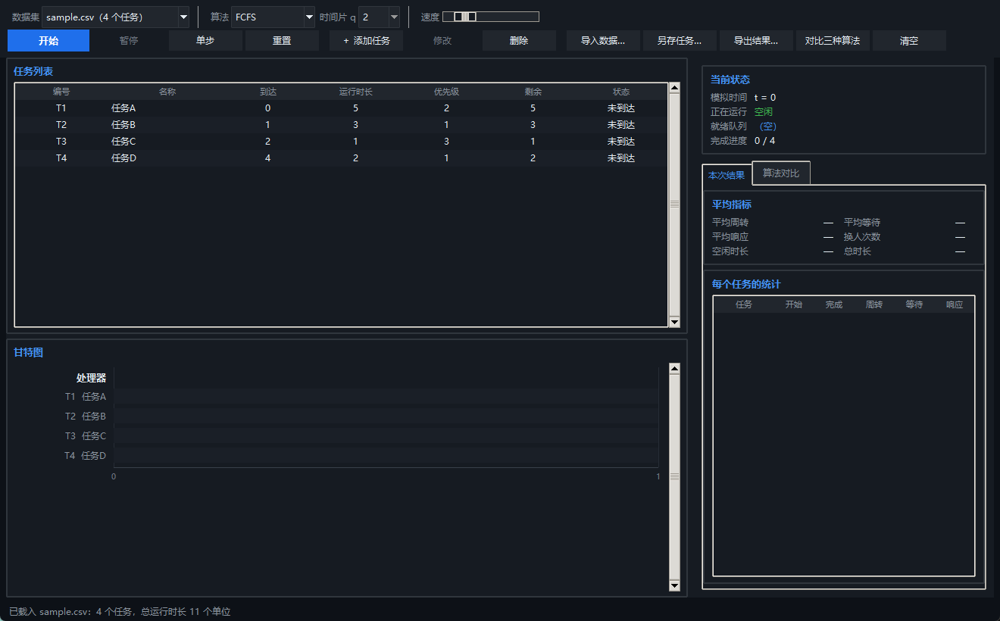
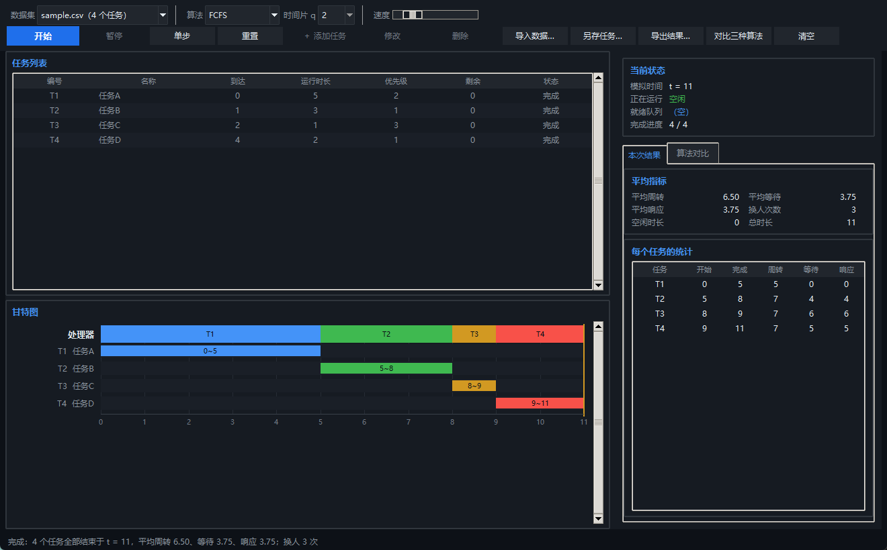
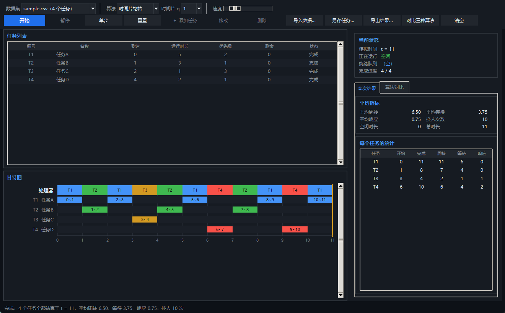
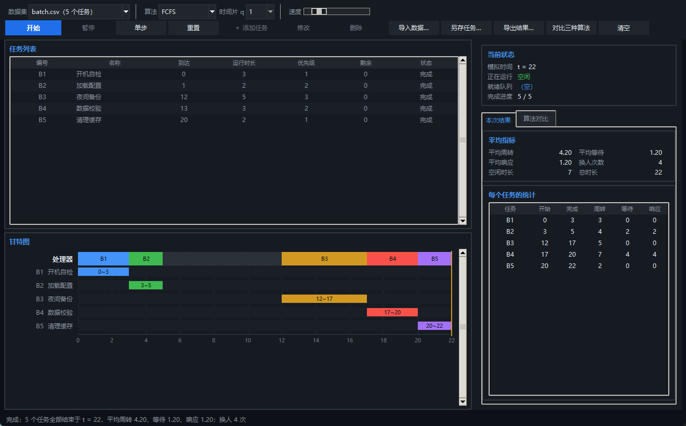
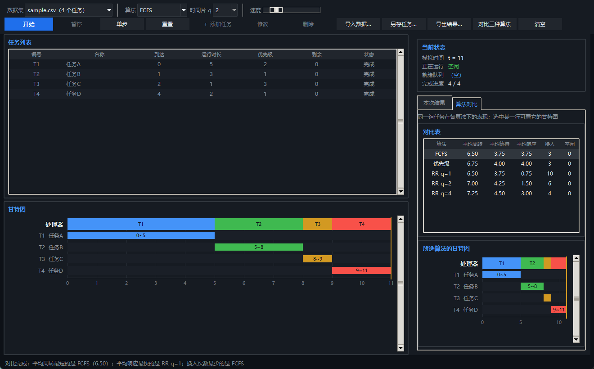

# 任务调度模拟器设计与实现

**《数据结构实践》课程实验报告**

| 项目 | 内容 |
|---|---|
| 实验选题 | 选题二 · 任务调度模拟器 |
| 实现语言 | Python 3（Tkinter） |
| 姓名 |  |
| 学号 |  |
| 班级 |  |
| 日期 |  |

---

## 目录

- [第一章 需求分析与问题建模](#第一章-需求分析与问题建模)
- [第二章 数据结构设计](#第二章-数据结构设计)
- [第三章 算法设计与实现](#第三章-算法设计与实现)
- [第四章 系统演示与结果分析](#第四章-系统演示与结果分析)
- [第五章 总结与收获](#第五章-总结与收获)
- [附录](#附录)

---

## 第一章 需求分析与问题建模

### 1.1 问题背景

操作系统、打印服务、生产流水线里都有同一个问题：一堆任务等着用同一个处理资源，谁先上？让先来的先做最公平，但一个长任务会把后面所有短任务一起卡住；让优先级高的先做能保证要紧的事不被耽误，但优先级低的任务可能永远排不上；给每个任务一小段时间轮流做，响应变快了，可换人本身也要花代价。

本实践要做的就是把这三种策略都实现出来，在同一组任务上跑一遍，用数据说明它们各自的取舍。

### 1.2 任务模型

每个任务由七个属性描述，与任务书的规定一一对应：

| 属性 | 含义 | 取值约束 |
|---|---|---|
| `task_id` | 唯一标识 | 非空，全局不重复 |
| `name` | 描述性名称 | 非空字符串 |
| `arrival_time` | 进入系统的时刻 | 非负整数 |
| `burst_time` | 完成所需的处理时间 | 正整数（**不能为 0**） |
| `priority` | 调度优先程度 | 非负整数，**数值越小优先级越高** |
| `remaining_time` | 尚未完成的运行时间 | 初值等于 `burst_time`，随运行递减 |
| `state` | 当前所处阶段 | 未到达 / 就绪 / 运行 / 完成 |

七个属性里前五个是**静态定义**，后两个是**运行期状态**。这个区分在实现上很重要：模板只保存前五个，每次模拟开始时克隆出一批带状态的实例，因此同一组任务可以被反复用不同算法跑而互不干扰（见 3.4 节"公平比较"）。

### 1.3 状态转换

```
                 到达时刻到达
   未到达 ────────────────────────► 就绪
                                    │  ▲
                        被调度      │  │  时间片用尽，回到队尾
                                    ▼  │
                                  运行 │
                                    │  │
                       运行完毕      │  │
                                    ▼  │
                                 完成 ─┘（终态）
```

- **未到达 → 就绪**：模拟时钟走到该任务的 `arrival_time` 时发生；
- **就绪 → 运行**：处理器空闲时被调度选中；
- **运行 → 就绪**：只发生在时间片轮转里，时间片用尽而任务尚未完成；
- **运行 → 完成**：`remaining_time` 减到 0，此时记下完成时刻。

四态互斥，且"完成"是终态——一个任务不会再从完成回到就绪。

### 1.4 模型假设

任务书规定的简化模型：

1. **单处理器**，同一时刻只能有一个任务在运行；
2. **单段计算任务**，任务一旦开始就只消耗处理器，不存在"先算一半去等 I/O 再回来"的情况；
3. **不考虑 I/O 阻塞**，任务进入就绪队列后除了等待处理器不会因别的原因停下；
4. **不考虑上下文切换开销**，换人本身不耗时（但换人**次数**仍然被统计出来，因为它反映调度策略的碎片程度，见第四章）；
5. 所有时间都是**模拟时间**，界面动画的快慢不影响任何调度结果。

### 1.5 处理规则

任务书为了保证实验可复现，给出了四条统一规定，实现时必须逐条落实：

| 规定 | 实现方式 |
|---|---|
| 到达时间相同时，按数据输入顺序处理 | 读入时为每个任务记下**输入序号** `seq`，到达序列按 `(arrival_time, seq)` 排序 |
| 优先级相同时，按到达时间和输入顺序决定执行顺序 | 优先队列的排序键取 `(priority, arrival_time, seq)` 三元组 |
| 处理器空闲且没有就绪任务时，推进到下一任务的到达时刻，并记录空闲区间 | 引擎每个时间单位都记账，空闲的单位记进甘特图的"空闲段" |
| 所有时间为模拟时间，界面动画速度不得影响调度结果 | 动画只是"按速度连续调用同一个 `step()`"，与单步执行推进的是同一个引擎 |

四条里第一条和第二条最容易被忽略。第三条、第四条看似废话，但它们是**结果可复现**的保证：如果实现里用了集合或字典的遍历顺序来打破平局，同一份数据在不同次运行下会给出不同的调度结果，实验就白做了。

---

## 第二章 数据结构设计

### 2.1 三类数据

| 数据 | 用途 | 实现 |
|---|---|---|
| **任务列表** | 保存全部任务的属性与状态 | `list[Task]`，按输入顺序 |
| **就绪队列** | 决定下一个运行谁 | 依算法而定：FIFO 队列或二叉堆（见 2.2、2.3） |
| **执行日志** | 画甘特图、算统计指标 | `Timeline`：按时间顺序记录每个单位由谁占用 |

### 2.2 FCFS 与 RR 为什么用 FIFO 队列

先来先服务的规则就是"按到达顺序排队，后来的不能插队"——这正是队列的定义。时间片轮转也用它，只不过多了一条"用完时间片回到队尾"的动作，而"回到队尾"本身就是队列操作。

两者的结构都选了 `collections.deque` 而不是 `list`：

| 操作 | `list` | `deque` |
|---|---|---|
| 从队首取出 | `pop(0)`，需要把后面所有元素前移，**O(n)** | `popleft()`，**O(1)** |
| 从队尾加入 | `append()`，O(1) | `append()`，O(1) |

对 n 个任务，用 `list` 会让"取下一个"这一步变成 O(n)，整个调度退化成 O(n·B)；用 `deque` 则是 O(1)。任务书明确要求"允许使用标准库容器，但需要说明其底层结构与主要操作复杂度"，这一处正是该说清楚的地方。

**那链表呢？** 单链表在队首删除和队尾插入也都是 O(1)，理论上同样能用。但在 Python 里没有现成的侵入式链表，自己写要么多维护一个尾指针（还得小心空链表时头尾同时更新），要么退化成双向链表；每个节点还要额外占用一个到两个指针的空间。`deque` 底层是分块数组，队首队尾都是 O(1) 且常数更小，缓存局部性也更好。所以这里的选择是：**三种结构在渐进复杂度上打平，但 `deque` 在常数与实现成本上胜出**。链表真正有优势的场景是"任务已经在链表里、需要 O(1) 从中间摘除"，而本模型只在队首取、在队尾加，用不上这个能力。

### 2.3 优先级调度为什么用堆

优先级调度每一轮要回答的问题是"就绪任务里谁的优先级最高"，也就是**动态集合上的取最小**。候选结构：

| 结构 | 取最小 | 插入 | 适合吗 |
|---|---|---|---|
| 无序数组 | O(n) 线性扫描 | O(1) | 任务多时每轮都扫一遍，太慢 |
| 有序数组 | O(1) | O(n) 插入时要挪位置 | 插入频繁，不合适 |
| **二叉堆** | **O(log n)** | **O(log n)** | **两项都是对数级，合适** |

Python 的 `heapq` 是最小堆，而任务书规定"数值越小优先级越高"，两者方向恰好一致，可以直接用 priority 作为键，不需要任何取反技巧。

### 2.4 平局怎么保证稳定、可复现

这是本章最容易出错的一点。二叉堆**不保证相同键值的元素按插入顺序弹出**——堆只维护"父节点不大于子节点"这一条性质，同优先级的两个任务谁先出来取决于堆的内部形状。

所以如果只拿 `priority` 当键，同一份数据两次运行可能给出不同的调度顺序。任务书的可复现性规定就此落空。

解决办法是把排序键扩展成三元组：

```
(priority, arrival_time, seq)
```

- `priority` 保证优先级高的先出；
- `arrival_time` 保证同优先级时先到的先出；
- `seq` 是输入顺序，**全局唯一**，因此整个键不会出现并列，堆的行为被完全确定。

`seq` 的作用是为"到达时间也相同"的情况兜底。某一对任务到达时刻相同时，前两个分量还是相等，这时候就必须靠 `seq` 来定序了。测试里专门有一组用例（同时到达 + 同优先级，连跑十次）来验证这一点。

### 2.5 执行日志与甘特图

每次推进一个时间单位，就把"这一格由谁占用"追加进 `Timeline`。相邻且属于同一任务的格子会被**自动合并**成一段，所以"连续执行 5 个单位"在日志里是一条长度为 5 的记录，而不是 5 条。这样：

- 甘特图上每一段矩形对应日志里的一条记录；
- 时间片轮转下同一个任务被切成几段，就是日志里有几条属于它的记录——**切分的段数直接反映它被抢占了几次**；
- 空闲区间用 `task_id = None` 表示，与"任务在运行"区分开。

统计指标（周转、等待、响应时间）不单独存储，而是由任务的 `arrival_time` / `start_time` / `finish_time` 三个时刻**按公式现算**。这样不会出现"改了运行逻辑忘了同步更新统计"的隐患。

---

## 第三章 算法设计与实现

### 3.1 三种算法的伪代码

三种算法共用同一套模拟骨架，差别只在"从就绪集合里挑谁"这一步：

```
模拟主循环（每推进一个时间单位）:
    ① 处理到达     ── 本时刻到达的任务按输入顺序进入就绪集合
    ② 处理时间片   ── 上一单位用尽时间片的任务，此刻回到队尾
    ③ 调度         ── 若处理器空闲，向调度算法要一个任务
    ④ 运行         ── 执行一个单位，扣减剩余时长
                     ├─ 剩余为 0  → 记完成时刻，任务结束
                     └─ 否则      → 检查时间片是否用尽
```

**FCFS**

```
enqueue(task):  队尾追加
pick():         队首弹出（空则返回空）
```

**非抢占式优先级调度**

```
enqueue(task):  压入最小堆，键 = (priority, arrival_time, seq)
pick():         弹出堆顶
```

**时间片轮转**

```
enqueue(task):  队尾追加
pick():         队首弹出
时间片用尽:      当前任务回到队尾，重新排队
```

三种算法的"非抢占"性质都体现在**调度决策只在处理器空闲时发生**：高优先级任务到达时不会打断正在运行的任务，它只是排进就绪集合等着。

### 3.2 四类处理逻辑

主循环里的四个步骤，分别对应任务书要求说明的四类情况：

**① 任务到达。** 引擎维护一个按 `(arrival_time, seq)` 排序好的到达序列和一个游标。每个时间单位开头，把所有 `arrival_time ≤ 当前时刻` 的任务一次性送进就绪集合，游标前移。因为序列已经排好序，这一步是均摊 O(1) 的（每个任务一生只入队一次）。

**② 时间片耗尽。** 这个动作被**刻意推迟**到下一个时间单位的开头，理由见 3.3。

**③ 任务完成。** 剩余时长减到 0 时记下完成时刻 `C`，状态置为"完成"，处理器随即空闲，下一轮循环会重新调度。

**④ 处理器空闲。** 本时刻没有任务到达、就绪集合也是空的——记录一个空闲单位进日志，时钟照常前进。任务书要求"推进到下一任务的到达时刻"并"记录空闲区间"，逐单位推进同样满足：`Timeline` 会把连续的空闲单位合并成一段完整的区间，效果与一次性跳跃完全一致，而且还能支持逐单位的单步演示。

### 3.3 RR 中新任务入队与当前任务回队尾的先后顺序

这是整个实现里**最容易写反、也最值得单独说**的一处。任务书的规定是：

> 时间片内新到达的任务按到达顺序进入队尾；**恰好在时间片结束时到达的任务，先入队，再将未完成的当前任务放回队尾**。

也就是说，在时间片结束的那个时刻，"新到达的任务"要排在"被放回的当前任务"**前面**。

实现手法是把"回队尾"这个动作拆成两步：

```python
def step(self):
    # ① 本时刻到达的任务先入队           ← 先
    self._admit_arrivals()

    # ② 上一个单位结束时用完时间片的任务，现在才回队尾   ← 后
    if self._pending_requeue is not None:
        self.scheduler.enqueue(self._pending_requeue)
        self._pending_requeue = None

    # ③ 处理器空着就调度
    ...
```

运行一个单位时如果发现时间片用完，**不立即入队**，而是把它记在 `_pending_requeue` 里；等到下一个时间单位开头，先处理到达、再把这个挂起的任务放进队尾。顺序天然就对了。

用一个最小例子可以看清两种实现的差别：

```
A：到达 0，时长 2      B：到达 1，时长 1      时间片 q = 1
```

t=1 时，A 的时间片刚好用完，而 B 恰好在 t=1 到达。

| 实现 | t=1 时刻的队列变化 | [1,2) 谁在运行 |
|---|---|---|
| **正确**（先入队后回队尾） | B 入队 → `[B]`；A 回队尾 → `[B, A]` | **B** |
| 写反（先回队尾后入队） | A 回队尾 → `[A]`；B 入队 → `[A, B]` | A |

两种实现算出的甘特图完全不同。测试里专门有 `test_rr_boundary_rule` 用这个例子把规则钉死。

### 3.4 公平比较：每次运行前恢复初始状态

任务书要求"每次运行前恢复任务初始状态，保证比较公平"。实现上用了两层隔离：

- 界面里保存的 `tasks` 只含**静态定义**（前五个属性），模拟过程不会碰它们；
- 每次模拟开始时，引擎对定义逐个 `clone()` 出一批全新实例，运行期状态全部回到初值。

因此"用三种算法跑同一组任务"天然是公平的：三次运行面对的是三份独立、状态完全相同的副本。测试里有一条用例专门验证这点——跑完几种算法后再跑一次 FCFS，结果与第一次逐格相同，而且原始定义的状态字段没有被写入过。

### 3.5 逐时间单位模拟，而不是事件驱动

采用**逐时间单位模拟**：每调用一次 `step()` 推进一个时间单位。

选择它的理由有三个：

1. 任务书规定"单步执行统一定义为推进一个模拟时间单位"，逐单位推进与这条规定天然吻合；
2. 空闲区间的记录变得平凡——空闲的单位照样记账，不需要额外的"跳跃并补记"逻辑；
3. 演示动画的粒度与模拟的粒度一致，看到的就是算出来的。

代价是效率：即使处理器空着，时钟也要一格一格走。但由于下面这条复杂度分析可以看出总步数有明确上界，这个代价可以接受。

### 3.6 复杂度分析

设任务数为 **n**，任务总运行时长为 **B = Σ Bᵢ**，最后一个到达时刻为 **A**。

**模拟步数**：时钟从 0 走到全部任务结束，期间每个单位要么在运行某个任务（共 B 个单位），要么在空闲（不超过 A 个单位，因为最后一个任务到达后处理器不会再空着）。所以总步数是 **O(B + A)**。

**每一步的代价**：

| 算法 | 入队 | 取下一个 | 每一步代价 |
|---|---|---|---|
| FCFS | O(1) | O(1) | O(1) |
| 非抢占式优先级 | O(log n) | O(log n) | O(log n) |
| 时间片轮转 | O(1) | O(1) | O(1) |

**总体复杂度**：

| 算法 | 时间 | 空间 |
|---|---|---|
| FCFS | **O(B)** | O(n) |
| 优先级调度 | **O(B log n)** | O(n) |
| 时间片轮转 | **O(B)** | O(n) |

三种算法都**不能笼统地写成 O(n)**：真正决定耗时的不是任务个数，而是所有任务加起来要跑多久（B）。n 只影响每次堆操作的代价，而且只对优先级调度有影响。

**时间片大小对时间片轮转的影响**是这里最需要单独讨论的一点。RR 的时间复杂度虽然写作 O(B)，但**调度的次数**与时间片 q 强相关：

- 每个任务大约会被抢占 **Bᵢ / q** 次，全部任务加起来是 **⌈B/q⌉** 量级的调度事件；
- q 越小，调度越频繁。每次调度都要保存现场、恢复现场、操作就绪队列——虽然本模型按任务书要求不计切换开销，但这个次数是可以统计的（报告里的"换人次数"一列）。

也就是说：**B 决定了模拟要跑多少步，而 q 决定了其中有多少步是"换人"**。q 取到不小于最长任务时长时，RR 退化为 FCFS，一次换人都不多发生；q = 1 时换人次数最多可达任务数的数倍。第四章的实验数据完整地展示了这条规律。

---

## 第四章 系统演示与结果分析

### 4.1 界面与操作



界面分四块：顶部两行工具栏负责选数据集、算法、时间片与操作按钮；左上角是任务列表，展示七个属性并随模拟实时更新（正在运行的任务高亮为绿色，就绪任务为蓝色，已完成的变暗）；左下角是甘特图；右侧是当前状态、统计结果与算法对比。


演示过程中，模拟时间、正在运行的任务、就绪队列都在右侧实时刷新，甘特图上的执行片段逐格长出来，当前时刻有一条黄色指示线。





上面这张是时间片 q=1 的结果。对比最上方"处理器"行与下面各任务行，可以清楚看到任务被切成了多段：T1 被切成 5 段、T2 被切成 3 段，处理器在它们之间来回切换了 10 次。



分批到达的数据集里，两批任务之间处理器无事可做，甘特图在 [5,12) 上画出一段虚线槽，右侧统计里"空闲时长 7"与之一致。

其他操作：任务列表下方可以添加 / 修改 / 删除任务（**只在模拟开始前或重置后可用**，符合任务书要求）；工具栏的"导入数据…"读入 CSV 或 JSON，"导出结果…"把每个任务的开始 / 完成时刻与三项统计指标写成 CSV。

### 4.2 正确性验证：手工推演核对

用于核对的是任务书给的示例数据：

```
T1,任务A,0,5,2
T2,任务B,1,3,1
T3,任务C,2,1,3
T4,任务D,4,2,1
```

**FCFS 的完整推演**（T1 从 0 跑到 5，期间到达的 T2、T3 只能排队）：

| 任务 | 执行区间 | 周转 T = C−A | 等待 W = T−B | 响应 R = S−A |
|---|---|---|---|---|
| T1 | [0,5) | 5 | 0 | 0 |
| T2 | [5,8) | 7 | 4 | 4 |
| T3 | [8,9) | 7 | 6 | 6 |
| T4 | [9,11) | 7 | 5 | 5 |
| **平均** | | **6.50** | **3.75** | **3.75** |

程序输出与任务书列出的预期结果**逐格一致**，测试脚本里有一组用例把这张表的每一格都硬编码成断言。

**换一个算法手工推演，看结果是否仍然对得上。** 优先级调度下，T1 依然从 0 跑到 5（T2 虽然优先级更高，但**不抢占**）；t=5 时就绪集合里 T2(优先级 1)、T4(优先级 1) 并列，按到达时间早的 T2 先跑：

| 任务 | 执行区间 | T | W | R |
|---|---|---|---|---|
| T1 | [0,5) | 5 | 0 | 0 |
| T2 | [5,8) | 7 | 4 | 4 |
| T4 | [8,10) | 6 | 4 | 4 |
| T3 | [10,11) | 9 | 8 | 8 |
| **平均** | | **6.75** | **4.00** | **4.00** |

T3 被排到了最后（优先级 3 最低），等待时间从 6 涨到 8。程序输出与手工推演同样逐项吻合。

### 4.3 对比实验

界面上的「对比三种算法」会把同一组任务在三种算法（以及 RR 的多个时间片）下各跑一遍，列成一张表；**在表里选中某一行，下方会画出那个算法对应的甘特图**——对比不只看数字，也能直接看到执行形态的差别（比如同一个任务在 FCFS 下是一整段，在 RR q=1 下被切成了好几截）：



这些数字与下面使用 `tools/benchmark.py` 批量跑五份数据集得到的结果一致。挑三组有代表性的：

**① 任务书示例数据（4 个任务，总运行时长 11）**

| 算法 | 时间片 | 平均周转 | 平均等待 | 平均响应 | 换人次数 |
|---|---:|---:|---:|---:|---:|
| FCFS | — | **6.50** | **3.75** | 3.75 | 3 |
| 优先级调度 | — | 6.75 | 4.00 | 4.00 | 3 |
| RR | 1 | 6.50 | 3.75 | **0.75** | 10 |
| RR | 4 | 7.25 | 4.50 | 3.00 | 4 |

**② 长短任务混合（1 个 12 单位的长任务 + 5 个短任务）**

| 算法 | 时间片 | 平均周转 | 平均等待 | 平均响应 | 换人次数 |
|---|---:|---:|---:|---:|---:|
| FCFS | — | 14.50 | 10.00 | 10.00 | 5 |
| 优先级调度 | — | 14.83 | 10.33 | 10.33 | 5 |
| RR | 1 | **11.50** | **7.00** | **0.83** | 23 |
| RR | 4 | 13.00 | 8.50 | 4.67 | 8 |

**③ 同时到达（4 个任务，到达时刻都是 0）**

| 算法 | 时间片 | 平均周转 | 平均等待 | 平均响应 | 换人次数 |
|---|---:|---:|---:|---:|---:|
| FCFS | — | 12.25 | 8.50 | 8.50 | 3 |
| 优先级调度 | — | 12.25 | 8.50 | 8.50 | 3 |
| RR | 1 | **9.25** | **5.50** | 1.50 | 11 |

从这三组数据可以看到几件事：

**第一，短任务会被长任务拖累，而 RR 能明显缓解这个问题。** 第二组里 FCFS 的平均等待是 10.00 —— 一个 12 单位的长任务占住处理器，后面五个短任务只能干等。换成 RR q=1 后平均等待降到 7.00，平均响应更是从 10.00 降到 0.83。这是"短任务为什么要等很久"这个问题的直接答案：**问题不在任务自己，在于它前面排了个不会被打断的长任务**。

**第二，同时到达时 FCFS 与优先级调度的结果完全相同。** 第三组里两者逐项一致，这不是巧合：所有任务在同一时刻到达，非抢占式调度下先排队的会一直跑到完成，优先级根本没有机会发挥作用。这提醒我们，**比较算法必须先看数据特征**，在一组"人人同时到场"的数据上比较 FCFS 和优先级调度是得不出结论的。

**第三，优先级调度不一定比 FCFS 好。** 第一组和第二组里优先级调度的三项指标都略差于 FCFS。原因是本模型采用**非抢占**：高优先级任务到达时不能打断已经在运行的任务，只能等。当高优先级任务到达得比较晚时，它们的"高优先级"就形同虚设，反而可能因为打乱原有的到达顺序而让整体指标变差。这是"不能仅依据一组数据认定某种算法始终最优"的一个具体例子。

### 4.4 RR 的时间片怎么选

时间片是 RR 唯一可调的参数，把它的影响单独测出来（任务书示例数据）：

| 时间片 q | 平均周转 | 平均等待 | 平均响应 | 换人次数 |
|---:|---:|---:|---:|---:|
| 1 | 6.50 | 3.75 | **0.75** | **10** |
| 2 | 7.00 | 4.25 | 1.50 | 6 |
| 4 | 7.25 | 4.50 | 3.00 | 4 |
| 8 | **6.50** | **3.75** | 3.75 | **3** |

两条相反的趋势同时出现：

- **q 越小，响应时间越短**：0.75 → 1.50 → 3.00 → 3.75。因为轮一圈更快，后到的任务能更早拿到处理器；
- **q 越小，换人越频繁**：3 → 4 → 6 → 10。每一次换人都意味着保存现场、恢复现场的开销。本模型按任务书要求不计切换开销，但**次数**是实打实增加的。

而且平均周转并不是"越小越好"——q=8 时的周转（6.50）反而优于 q=4（7.25）。因为 q 一旦不小于最长任务的时长，RR 就退化成 FCFS 了：此时不再有中途换人，长任务一次跑完，周转反而更好。**"时间片变小一定会让平均周转变好"是个错觉**，它改善的是响应时间，代价是调度次数。

这组数据把任务书提示里的那句话落到了实处：*平均等待时间衡量的是调度策略的效果，程序运行耗时衡量的是实现效率，两者不能混为一谈*；而换人次数是第三种东西 —— 它是**调度策略自身带来的开销**，既不属于前者也不属于后者。

### 4.5 异常与边界测试

任务书列出的边界情况，测试脚本逐一覆盖：

| 情况 | 预期行为 | 实测 |
|---|---|---|
| 任务列表为空 | 模拟立即结束，不崩溃 | ✓ |
| 只有一个任务 | 从到达时刻连续运行到完成 | ✓ |
| 多个任务同时到达且优先级相同 | 严格按输入顺序执行，连跑十次结果完全相同 | ✓ |
| 首个任务在时间 0 之后到达 | 开头记录一段空闲区间 | ✓ |
| 运行时长恰好等于时间片 | 用完即完成，**不**回到队尾 | ✓ |
| 运行时长小于时间片 | 提前完成，立即调度下一个 | ✓ |
| 新任务恰好在时间片结束时到达 | **先入队，再把当前任务放回队尾**（见 3.3） | ✓ |
| 文件格式错误 | 报错并指出是哪个字段 | ✓ |
| 任务编号重复 | 报错并指出重复的两个位置 | ✓ |
| 时间片非法（0 或负数） | 拒绝并提示 | ✓ |

除了这些定点用例，测试脚本还会用**随机数据**反复验证五条任何一次合法调度都必须满足的不变量：

1. 甘特图连续覆盖 `[0, 总时长)`，既不留缝隙也不重叠；
2. 每个任务被执行的总时长恰好等于它的运行时长；
3. 任务不会在自己的到达时刻之前被运行；
4. 三项统计指标与三个时刻满足 `T = C − A`、`W = T − B`、`R = S − A`，且非负；
5. 非抢占式调度下每个任务只有一整段执行区间（RR 除外）。

随机用例共 60 轮、每轮覆盖 3 种算法 × 3 个时间片，累计三万余个断言全部通过。

不变量检查关心的是"结果自不自洽"，它不关心实现怎么写的。`tests/test_cross_check.py` 补上了互补的一层：把同一套调度规则**用完全不同的代码路径再实现一遍**（就绪集合用普通 list 而不是 deque/heapq、优先级靠线性扫描而不是堆顶、到达处理靠每个时间单位全表扫描而不是预排序加游标），然后用 80 组随机数据**逐格比对两张甘特图**，另外对每个任务的开始 / 完成时刻也逐一核对。两条路只有"规则"是共用的，任何一处编码疏漏都会让某组数据对不上。这层验证同样全部通过（累计比对 480 组用例）。

---

## 第五章 总结与收获

### 5.1 队列和优先队列在这里起了什么作用

FCFS 和时间片轮转的就绪集合都是队列，但两者对队列的用法不一样：FCFS 只从队首取、往队尾加；RR 多了一个"把刚跑过一轮的任务再放回队尾"的动作。**正是这一个动作，把队列变成了"轮转"**，也让响应时间从"取决于前面有多少任务"变成"取决于时间片有多长"。

优先级调度换成了堆，是因为它要回答的问题变了：队列回答的是"谁来得早"，堆回答的是"谁最要紧"。这两个问题的性质不同——前者只依赖插入顺序，后者要求每次都从动态集合里挑出极值。用队列去实现优先级调度当然也行，只是每次都得扫一遍就绪队列，复杂度从 O(log n) 退化到 O(n)。

### 5.2 三种算法的差异

| | 效率 | 公平性 | 响应速度 |
|---|---|---|---|
| FCFS | 周转指标通常不错 | 按到达顺序，直观公平 | **最差**，一个长任务会拖住所有人 |
| 优先级调度 | 取决于优先级设置是否合理 | 按重要性而非先来后到 | 高优先级任务快，低优先级可能长期等待 |
| 时间片轮转 | 换人开销随 q 减小而增加 | 人人有份，最公平 | **最好**，与任务长短无关 |

从实验数据看，没有哪个算法在所有指标上都赢。RR 在长短任务混合的场景里全面占优，但在任务重叠不多时，它的**周转与等待时间**可能反而不如 FCFS（batch 数据集：FCFS 4.20/1.20 对 RR q=1 的 4.60/1.60），同时还多付了 12 次换人的开销——不过它的**平均响应时间 0.00 仍是全场最好的**，也就是说拿周转与等待换来了响应。优先级调度在"要紧的事必须及时处理"时才体现出价值。

**算法选哪个，取决于业务更在乎什么**——这句话在跑完这组数据之后从口号变成了具体的数字。

### 5.3 开发中遇到的问题

**问题一：RR 的边界规则写反了。** 最初的实现是在运行完一个单位、发现时间片用尽时，立刻把当前任务放回队尾；而新到达的任务要到下一个单位开头才入队。这样一来，"恰好在时间片结束时到达的新任务"反而排到了被放回的任务后面，与任务书的规定正好相反。改法是不立即入队，把"回队尾"这个动作挂起（记在 `_pending_requeue` 里），等下一个单位开头先处理到达、再处理挂起的回队尾。**一行顺序的调整，改变了同一份数据的整张甘特图。**

**问题二：结果有时不可复现。** 优先级调度最初直接用 `priority` 当堆的排序键，结果同优先级的任务每次运行出来的顺序都不同。原因是**二叉堆不保证相同键值按插入顺序弹出**。解决办法是把键扩展成 `(priority, arrival_time, seq)` 三元组，用全局唯一的输入序号消除一切并列。

**问题三：动画速度污染了统计。** 一开始"开始"按钮的实现是每跑一个单位就 `sleep` 一下，导致模拟速度随界面动画快慢变化。改法是让引擎只提供 `step()` 这一个推进方式，"开始"按钮只是按节拍连续调用它——**动画是表现层的事，不应该渗进模型层**。

### 5.4 局限与改进方向

**当前模型的局限：**

- 按任务书要求**不计上下文切换开销**。现实中每次换人都有固定成本，这让"时间片越小越好"不再成立，会存在一个最优的 q；
- **单处理器**，不支持多核并行；
- 任务**不阻塞**，不考虑 I/O 等待；
- 优先级**静态不变**，低优先级任务可能长期得不到处理器（优先级老化可以先缓解这个问题）。

**可以继续做的改进**（任务书列出的选做项）：

- 增加 **SJF / SRTF** 算法，观察"已知运行时长"这个假设能带来多大收益；
- 实现**优先级老化**：等待越久优先级越高，观察它如何消除长等待；
- **模拟上下文切换开销**，把 4.4 节里"换人次数"那一列真正折算成时间，找出使总代价最小的 q；
- 支持**随机生成任务**并固定随机种子，让实验更容易复现；
- 支持**模拟过程中动态提交新任务**。

### 5.5 收获

最有价值的一点体会是：**"公平"和"高效"在这类问题里是冲突的，而冲突的大小取决于任务的结构**。同样三种算法，在"人人同时到场"的数据上几乎分不出高下（第三组实验里 FCFS 和优先级调度逐项相同），在"一个长任务压着五个短任务"的数据上却拉开了明显差距（平均等待 10.00 对 7.00）。如果不看数据特征就去比较算法，得到的结论很容易是错的。

其次是**边界规则的分量**。RR 那条"先入队再回队尾"的规定，看起来只是一句话，实现时顺序写反了程序照样能跑、指标照样算出来，只有拿一个精心构造的最小例子去比对手工推演才会露馅。这让我理解了为什么任务书要把这条规则单独写出来——**它是最容易被忽略、也最容易让整个实验数据失效的地方**。

---

## 附录

### A. 运行说明

只需要 Python 自带的 Tkinter，**不依赖任何第三方库**。

```bash
py run.py                      # 启动程序
py tests/test_scheduler.py     # 正确性测试（17 组，30627 个断言）
py tests/test_cross_check.py   # 交叉验证（另一份独立实现逐格比对）
py tests/test_ui.py            # 界面交互测试（8 组，64 个断言）
py tools/benchmark.py          # 对比实验
```

### B. 文件结构

```
├── run.py                        程序入口
├── src/
│   ├── models.py                 任务模型、执行记录、统计指标
│   ├── scheduler.py              三种调度算法（就绪集合 + 取下一个）
│   ├── engine.py                 逐时间单位的模拟引擎
│   ├── loader.py                 任务数据的读写与校验
│   └── ui/
│       ├── app.py                主窗口与演示调度
│       ├── gantt.py              甘特图画布
│       ├── task_table.py         任务列表控件
│       ├── report_panel.py       状态与结果面板
│       └── theme.py              配色与字体
├── data/                         五份测试数据（示例 / 同时到达 / 长短混合 /
│                                 分批到达 / 优先级混合）
├── tests/
│   ├── test_scheduler.py         正确性测试与不变量检查
│   ├── test_cross_check.py       与独立参考实现的交叉验证
│   └── test_ui.py                界面交互测试
├── tools/benchmark.py            对比实验
└── docs/                         本报告与界面截图
```

### C. 数据文件格式

**CSV**（任务书给的格式）：

```
task_id,name,arrival_time,burst_time,priority
T1,任务A,0,5,2
```

**JSON**：

```json
{"name": "示例数据",
 "tasks": [{"task_id": "T1", "name": "任务A",
            "arrival_time": 0, "burst_time": 5, "priority": 2}]}
```

两种格式读进来之后走的是同一套校验（`loader.validate`），非法数据会在载入阶段就被拒绝，不会带进模拟。

### D. 导出格式

"导出结果…"写出的 CSV 每行一个任务，列为：

```
task_id, name, arrival_time, burst_time, priority,
start_time, finish_time, turnaround_time, waiting_time, response_time
```

末尾追加一行平均值，可以直接拿去填报告里的对比表。
